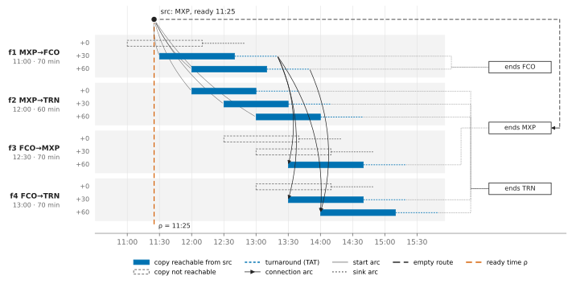
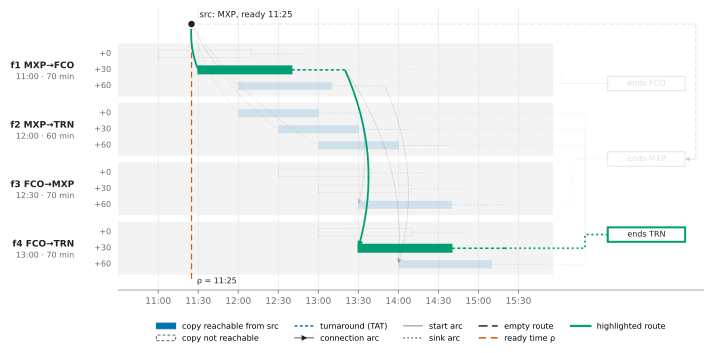
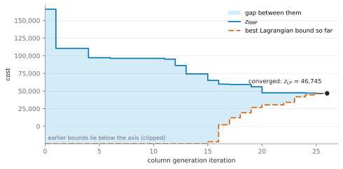
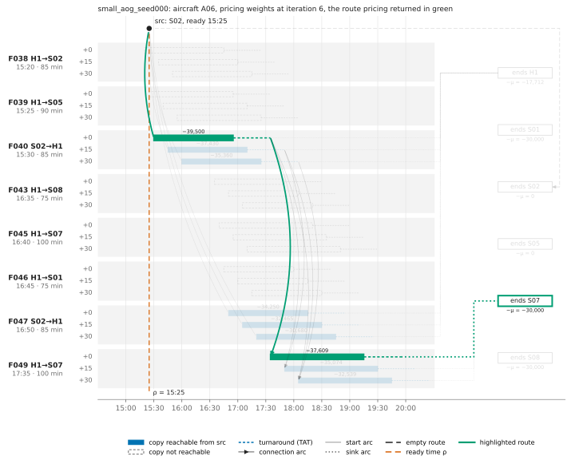
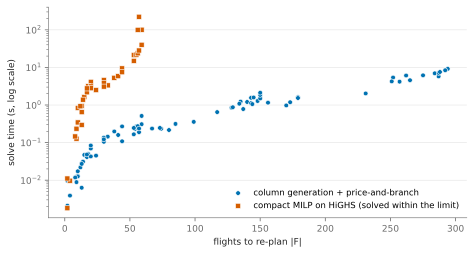
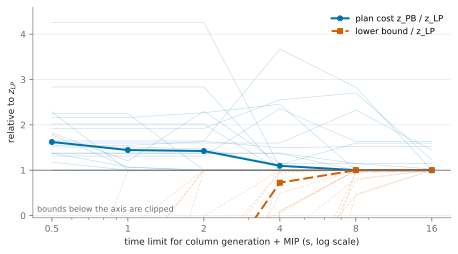
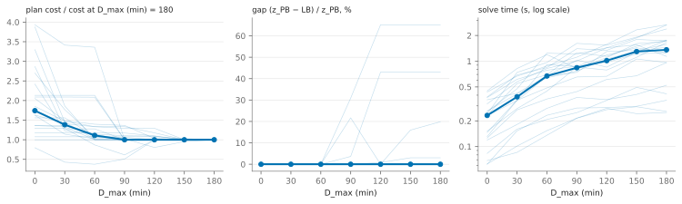
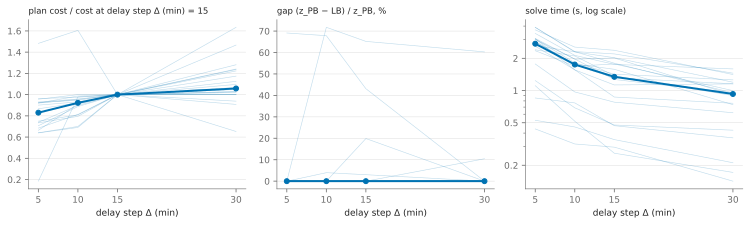
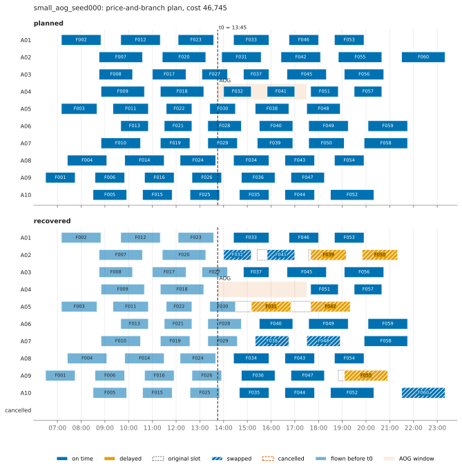

# Aircraft Recovery via Column Generation

An aircraft goes out of service (AOG) or an airport closes for a while, and the rest of the day's flights must be re-planned. This repository re-plans aircraft routes for a single-day airline schedule by delaying, swapping and cancelling flights, trading off passenger delay, cancellations, aircraft swaps and end-of-day aircraft positioning. The model is a set-partitioning master problem over aircraft routes, solved by column generation in Gurobi with a hand-written shortest-path pricing on acyclic connection networks, then turned into a plan by price-and-branch; a compact arc-flow MILP validates it on small instances.
<!-- results:headline:start -->
On 80 generated instances (4 to 40 aircraft, up to 294 flights to re-plan), column generation converged on 80, and the gap between the price-and-branch plan and the LP lower bound, (z_PB - LB) / z_PB, averaged 4.53% (at most 65.18%). The 20 large instances took 4.41 s in median and at most 9.18 s with Gurobi.
<!-- results:headline:end -->

Contents: [the problem](#the-problem-in-plain-words) · [a picture first](#a-picture-first) · [formulation](#formulation) · [column generation by hand](#column-generation-by-hand) · [algorithm](#algorithm-and-implementation) · [validation](#validation) · [results](#results) · [how to run](#how-to-run) · [repository](#repository-structure) · [limitations](#assumptions-and-limitations) · [extensions](#extensions) · [references](#references)

## The problem in plain words

- **The disruption.** An aircraft goes AOG mid-day: it is stuck at its current station from $`t_1`$ to $`t_2`$. Or an airport closes: no departures and no arrivals there during $`[t_a, t_b)`$.
- **The decisions.** Each remaining flight can be flown late, on a grid of delays $`0, \Delta, 2\Delta, \dots, D_{\max}`$; flown by a different aircraft than planned (a swap); or cancelled.
- **The costs.** Delay costs $`c^{\text{del}}`$ per passenger-minute, a cancellation $`c^{\text{canc}}_0 + c^{\text{canc}}_1 p_f`$ for a flight with $`p_f`$ passengers, a swap $`c^{\text{swap}}`$ per flight, and an aircraft missing at its planned overnight station $`c^{\text{pos}}`$ (values below).
- **End-of-day positioning.** Tomorrow's schedule needs $`b_s`$ aircraft at station $`s`$ tonight: the number whose planned rotation ends there. The model plans a single day, so tomorrow enters only through this requirement and its shortfall penalty.
- **What is frozen.** The disruption becomes known at the recovery time $`t_0`$ (the start of the AOG or of the closure). Flights that have already departed by then are history: they are assumed to have flown on schedule and only determine where each aircraft is and when it is free again.

The cost parameters and delay grid used throughout (`config.yaml`):

<!-- results:costs:start -->
| parameter | value |
|---|---:|
| delay, per passenger-minute | 1 |
| cancellation, fixed + per passenger | 5,000 + 250 |
| swap, per flight | 500 |
| end-of-day shortfall, per aircraft | 30,000 |
| delay step Δ / largest delay D_max (min) | 15 / 180 (lower if the elementarity cap requires) |
| minimum turnaround τ (min) | 40 |
<!-- results:costs:end -->

## A picture first

Every aircraft has a connection network: the days it can physically fly. Here is the network of the one aircraft of the toy instance `examples/toy_network.json` (4 flights, delays 0, 30 and 60 minutes), and one route through it.



*The toy network: every copy reachable from A's ready state is filled.*



*One route, f1 at +30 then f4 at +30, ending at TRN: one column of the master problem.*

How to read it:

- Each lane is one flight; each row in a lane is one delay. A bar is a flight copy $`(f, d)`$ in the air; its dashed tail is the turnaround $`\tau`$.
- The red dashed line is the ready time $`\rho`$: aircraft A is still in the air at the recovery time, and is free once its last frozen flight has landed and turned around. Copies leaving before $`\rho`$, or from the wrong station, cannot be reached and are drawn as dashed outlines.
- Arcs are feasible connections: land, turn around, depart from the same station. The boxes on the right are end-of-day sinks, one per station.
- One path from the source to a box is one route, and one route is one column of the master problem. The dashed line along the top is the empty route: A stays on the ground.

## Formulation

### Sets and data

| Symbol | Meaning |
|---|---|
| $`K, S`$ | aircraft (one fleet type), stations |
| $`F`$ | flights still to operate at the recovery time |
| $`D = \lbrace 0, \Delta, 2\Delta, \dots, D_{\max}\rbrace`$ | allowed delays, step $`\Delta`$ |
| $`o_f, \delta_f, t_f, \beta_f, p_f, k^0_f`$ | origin, destination, scheduled departure, block time, passengers, planned aircraft of flight $`f`$ |
| $`\tau`$ | minimum turnaround, on-block to next off-block |
| $`b_s`$ | aircraft whose planned rotation ends at $`s`$; $`\sum_s b_s = \lvert K\rvert`$ |
| $`\hat k, [t_1, t_2)`$ | AOG aircraft and its unavailability window |
| $`\bar s, [t_a, t_b)`$ | closed station and closure window |
| $`t_0`$ | recovery time: $`t_1`$ for an AOG, $`t_a`$ for a closure |
| $`c^{\text{del}}, C_f = c^{\text{canc}}_0 + c^{\text{canc}}_1 p_f, c^{\text{swap}}, c^{\text{pos}}`$ | delay, cancellation, swap and shortfall costs |

### Preprocessing

Flights that departed before the recovery time are frozen, and each aircraft gets a ready state $`(s_k, \rho_k)`$:

$$
F=\lbrace f : t_f\ge t_0\rbrace,
\qquad
(s_k,\ \rho_k)=
\begin{cases}
\big(\text{start-of-day station of }k,\ \ t_0\big) & \text{if }k\text{ has no frozen flight}\\
\big(\delta_{\bar f_k},\ \ \max(t_0,\ t_{\bar f_k}+\beta_{\bar f_k}+\tau)\big) & \text{otherwise}
\end{cases}
$$

where $`\bar f_k`$ is the last frozen flight of $`k`$, and the AOG aircraft gets $`\rho_{\hat k} \leftarrow \max(\rho_{\hat k}, t_2)`$. The delay grid must stay below the elementarity cap:

$$
\bar D=\min_{f,g\in F:\ \delta_f=o_g}\big(\beta_f+\beta_g\big)+2\tau,
\qquad
D_{\max}<\bar D .
$$

In words: the solver only re-plans what has not happened yet; $`s_k`$ is where aircraft $`k`$ is at $`t_0`$ and $`\rho_k`$ the earliest time it can take off again. Flying a flight twice takes at least two block times and two turnarounds, so with $`D_{\max} < \bar D`$ no route can contain two copies of the same flight (proof in `docs/formulation.md` §2.3).

### The connection network

For each aircraft $`k`$, the nodes are a source $`\text{src}_k`$, a copy $`(f, d)`$ for every flight and delay ("$`f`$ departs $`d`$ minutes late"), and a sink $`\text{snk}_s`$ per station. Under a closure, copies that depart from or arrive at $`\bar s`$ inside the window are deleted.

| Arc | Exists if | Meaning |
|---|---|---|
| $`\text{src}_k\to(f,d)`$ | $`o_f=s_k`$ and $`t_f+d\ge\rho_k`$ | first flight of the day |
| $`(f,d)\to(g,e)`$ | $`\delta_f=o_g`$ and $`t_f+d+\beta_f+\tau\le t_g+e`$ | land, turn around, fly $`g`$ |
| $`(f,d)\to\text{snk}_{\delta_f}`$ | always | $`f`$ is the last flight |
| $`\text{src}_k\to\text{snk}_{s_k}`$ | always | stay on the ground |

In words: flights chain only where the previous one landed, after the turnaround, so departure times increase along every path and the graph is acyclic. Copy-to-copy arcs are the same for every aircraft; only the source and the swap costs differ.

### Routes

A route $`r \in R_k`$ is a path from $`\text{src}_k`$ to a sink. Its coefficients and cost are

$$
a_{fr}=[ r\text{ contains a copy of }f ],
\qquad
e_{sr}=[ r\text{ ends at }\text{snk}_s ],
\qquad
c_r=\sum_{(f,d)\in r}\Big(c^{\text{del}} p_f d\ +\ c^{\text{swap}} [ k^0_f\neq k ]\Big).
$$

In words: a route is one aircraft's complete day (which flights, with which delays, where it sleeps), and it costs the delays of its flights plus a swap penalty for each flight it takes over from another aircraft.

### The set-partitioning master

$$
\begin{aligned}
\min\quad & \sum_{k\in K}\sum_{r\in R_k}c_r\lambda_r\ +\ \sum_{f\in F}C_f z_f\ +\ \sum_{s\in S}c^{\text{pos}}y_s\\
\text{s.t.}\quad
& \sum_{k\in K}\sum_{r\in R_k}a_{fr}\lambda_r+z_f=1 && \forall f\in F && \text{(cover)}\\
& \sum_{r\in R_k}\lambda_r=1 && \forall k\in K && \text{(one route per aircraft)}\\
& \sum_{k\in K}\sum_{r\in R_k}e_{sr}\lambda_r+y_s\ge b_s && \forall s\in S && \text{(positioning)}\\
& \lambda_r\in\lbrace 0,1\rbrace,\quad z_f\in\lbrace 0,1\rbrace,\quad y_s\ge 0
\end{aligned}
$$

In words: every flight is flown exactly once or cancelled, every aircraft gets exactly one day plan (staying on the ground counts), and each aircraft missing from a station's end-of-day requirement costs $`c^{\text{pos}}`$. Each aircraft's own feasibility lives in its network, so the only interaction between aircraft is that no flight is flown twice. The LP relaxation has value $`z_{\text{LP}}`$; the restricted master (RMP) is the same LP over a subset of the routes, with value $`z_{\text{RMP}} \ge z_{\text{LP}}`$.

### The LP dual and what the prices mean

With multipliers $`\pi_f`$ (cover, free), $`\sigma_k`$ (one route, free) and $`\mu_s \ge 0`$ (positioning):

$$
\begin{aligned}
\max\quad & \sum_{f\in F}\pi_f+\sum_{k\in K}\sigma_k+\sum_{s\in S}b_s\mu_s\\
\text{s.t.}\quad
& \sum_f a_{fr}\pi_f+\sigma_k+\sum_s e_{sr}\mu_s\le c_r && \forall k\in K,\ r\in R_k\\
& \pi_f\le C_f \quad \forall f\in F, \qquad 0\le\mu_s\le c^{\text{pos}} \quad \forall s\in S
\end{aligned}
$$

In words: $`\pi_f`$ is the value of getting flight $`f`$ flown, never more than cancelling it costs; $`\mu_s`$ is the value of one more aircraft ending the day at $`s`$, never more than the shortfall penalty; and $`-\sigma_k \ge 0`$ is the marginal value of aircraft $`k`$ (the empty route's constraint gives $`\sigma_k \le -\mu_{s_k} \le 0`$). A route's constraint says that the value it collects cannot exceed its cost plus what its aircraft could produce elsewhere.

### Reduced cost and pricing as a shortest path

The reduced cost of route $`r \in R_k`$, and the pricing weights on $`G_k`$:

$$
\bar c_r=c_r-\sum_f a_{fr}\pi_f-\sigma_k-\sum_s e_{sr}\mu_s,
\qquad
w_k(f,d)=c^{\text{del}} p_f d+c^{\text{swap}} [ k^0_f\neq k ]-\pi_f .
$$

With $`L_k(v)`$ the cheapest weight of a path from $`\text{src}_k`$ to copy $`v`$ (including $`v`$), processed in departure order:

$$
L_k(v)=w_k(v)+\min\Big(\lbrace 0 : \text{src}_k\to v\in A_k\rbrace\ \cup\ \lbrace L_k(u) : u\to v\in A_k\rbrace\Big),
\qquad
\bar c_k^{\ast}=\min\Big(-\mu_{s_k},\ \min_{v=(f,d)}\big(L_k(v)-\mu_{\delta_f}\big)\Big)-\sigma_k .
$$

In words: given the prices, each aircraft looks for the day that collects the most flight value minus cost. A path's weight is a sum over its nodes and what can follow a copy depends only on the copy (a place and a time), so the best path through a copy starts with a best path to it, and the dynamic program touches each copy once. If $`\bar c_k^{\ast} \ge 0`$ for every aircraft, no route outside the RMP can improve it and $`z_{\text{RMP}} = z_{\text{LP}}`$.

### The Lagrangian bound

Relaxing the cover and positioning rows with the current RMP duals, and keeping the one-route rows, gives at every iteration

$$
z_{\text{RMP}}+\sum_{k\in K}\bar c_k^{\ast}\ \ \le\ \ z_{\text{LP}}\ \ \le\ \ z_{\text{RMP}} .
$$

In words: each aircraft can improve the current solution by at most $`\lvert\bar c_k^{\ast}\rvert`$, so the total can drop by at most the sum. The bound needs every aircraft priced exactly, holds at any multipliers with $`\mu \ge 0`$ (the code also evaluates it at smoothed duals, see below), and is not monotone, so the best value seen is kept; before convergence, $`z_{\text{RMP}}`$ itself is not a lower bound.

### Price-and-branch and the gap

After column generation, the master is solved with $`\lambda`$ and $`z`$ binary over the generated routes only, giving a plan of cost $`z_{\text{PB}}`$. With $`\text{LB} = z_{\text{LP}}`$ at convergence (the best Lagrangian bound if column generation stopped early), the true integer optimum $`z^{\ast}`$ on the delay grid satisfies

$$
\text{LB}\ \le\ z^{\ast}\ \le\ z_{\text{PB}},
\qquad
\text{gap}=\frac{z_{\text{PB}}-\text{LB}}{z_{\text{PB}}} .
$$

In words: the LP gives a floor and price-and-branch a plan; the gap says how far apart they can be. Price-and-branch is a heuristic, because no routes are generated during branching, so the gap bounds what it may lose.

### The compact arc-flow model

One binary $`x_{ka}`$ per aircraft $`k`$ and arc $`a \in A_k`$; an arc into copy $`(f, d)`$ costs $`c^{\text{del}} p_f d + c^{\text{swap}} [k^0_f \ne k]`$:

$$
\begin{aligned}
\min\quad & \sum_{k}\sum_{a\in A_k}c_{ka}x_{ka}+\sum_f C_f z_f+\sum_s c^{\text{pos}}y_s\\
\text{s.t.}\quad
& \sum_{a\in\text{out}(\text{src}_k)}x_{ka}=1 && \forall k\\
& \sum_{a\in\text{in}(v)}x_{ka}=\sum_{a\in\text{out}(v)}x_{ka} && \forall k,\ v=(f,d)\\
& \sum_k\sum_{d\in D}\ \sum_{a\in\text{in}(f,d)}x_{ka}+z_f=1 && \forall f\\
& \sum_k\sum_{a\in\text{in}(\text{snk}_s)}x_{ka}+y_s\ge b_s && \forall s\\
& x_{ka},\ z_f\in\lbrace 0,1\rbrace,\quad y_s\ge 0
\end{aligned}
$$

In words: each aircraft sends one unit of flow from its source to some sink, and the flows must cover every flight once or cancel it. Its LP relaxation equals the master's (Dantzig–Wolfe): each aircraft's flow polytope is bounded, its constraint matrix is a network matrix and so totally unimodular, its vertices are exactly the routes, and writing each flow as a convex combination of routes turns the compact model into the master. Decomposition does not tighten the bound here; it buys scale, a small master plus fast shortest paths instead of one MILP with a variable per aircraft and arc.

## Column generation by hand

[`examples/cg_by_hand.py`](examples/cg_by_hand.py) runs the real master and loop on an explicit route list, with no positioning rows and pricing by enumeration. Aircraft A is AOG and can only stay; spares P and Q can each fly one of two flights, f1 and f2, which leave at the same time; cancelling either flight costs 100. Route costs: P→f1 = 10, P→f2 = 20, Q→f1 = 10, Q→f2 = 50, staying = 0. Each iteration adds the best route of every aircraft whose reduced cost is negative.

<!-- results:cgbyhand:start -->
| Iteration | RMP cost | Prices (π_f1, π_f2) | σ (A, P, Q) | Routes added |
|---|---|---|---|---|
| 0 | 200 | (100, 100) | (0, 0, 0) | P→f1, Q→f1 |
| 1 | 110 | (10, 100) | (0, 0, 0) | P→f2, Q→f2 |
| 2 | 30 | (10, 20), one valid set | (0, 0, 0), one valid set | none: stop, LP optimum 30 |
<!-- results:cgbyhand:end -->

The prices start at the cancellation cost. f1's price drops once f1 is covered cheaply, which pushes the aircraft toward f2. The duals of the first two iterations are unique; those of the last are not, because the LP is degenerate, and the table shows the set the solver returned.

## Algorithm and implementation

**The loop** (`recovery/colgen.py`):

1. Solve the RMP as an LP: $`z_{\text{RMP}}`$ and duals $`(\pi, \sigma, \mu)`$.
2. Price every aircraft exactly on its network: $`\bar c_k^{\ast}`$ and the route that attains it.
3. Compute the Lagrangian bound and keep the best one.
4. Add every route with reduced cost below $`-\varepsilon`$ (`colgen.eps` in `config.yaml`); if there is none, stop: the RMP is optimal for the full LP, up to $`\lvert K \rvert \varepsilon`$. A route already in the pool is never added again: pricing returning one is a tolerance problem and only logged.
5. Purge stale columns if needed and return to step 1.

**Initialization.** The RMP starts with every $`z_f`$ and $`y_s`$, the empty route of every aircraft (so it is feasible from the start: cancel everything, keep every aircraft on the ground), and each aircraft's original rotation made feasible: its remaining flights in order, each at the smallest grid delay that respects the ready time and avoids closure-deleted copies, cut at the first flight with none.

**Pricing per aircraft** (`recovery/pricing.py`). The in-arcs of a copy leaving station $`s`$ at time $`t`$ are exactly the copies that land at $`s`$ and are turned around by $`t`$, plus the start arc. So the code sweeps "copy ready at its destination" and "copy departs" events in time order and keeps a running minimum of $`L_k`$ per station: the same recurrence, without listing the arcs, for all aircraft at once (vectorized over aircraft). The plain recurrence over the explicit arc lists is kept as a reference; both are tested against brute-force enumeration.

**Dual smoothing.** Set-partitioning duals jump between degenerate vertices and column generation tails off. Pricing therefore uses smoothed duals, $`\alpha`$ times the duals with the best Lagrangian bound so far plus $`1 - \alpha`$ times the current RMP duals (Wentges smoothing, $`\alpha`$ = `colgen.smoothing` in `config.yaml`). A route enters only if its reduced cost at the RMP duals is below $`-\varepsilon`$; if none does, the iteration prices again at the RMP duals, so the stopping test is unchanged. `experiments/run_tradeoff.py` compares smoothing weights on the large instances:

<!-- results:smoothing:start -->
| smoothing α | iterations (median) | iterations (max) | CG s (median) | converged | max relative z_LP difference to α = 0 |
|---|---:|---:|---:|---:|---:|
| 0 | 268 | 1637 | 8.08 | 20/20 | 0.0e+00 |
| 0.5 | 156 | 369 | 4.98 | 20/20 | 0.0e+00 |
| 0.8 | 150 | 258 | 4.56 | 20/20 | 0.0e+00 |
<!-- results:smoothing:end -->

With smoothing, column generation needs far fewer iterations, above all in the worst case, and it reaches the same $`z_{\text{LP}}`$ on every instance (last column).

Gurobi solves the master with primal simplex, which re-optimizes from the current basis after columns are added; its default algorithm choice tailed off badly here.

**Stopping and early termination.** Column generation stops at convergence; with a gap tolerance, a time limit or an iteration limit it can stop earlier, and then the reported lower bound is the best Lagrangian bound, not $`z_{\text{RMP}}`$.

**Column pool under the license limit.** pip-installed gurobipy is limited to 2000 variables and 2000 constraints. The master has $`\lvert F\rvert + \lvert K\rvert + \lvert S\rvert`$ rows and $`\lvert F\rvert`$ cancellation and $`\lvert S\rvert`$ shortfall columns, so the route pool is capped at $`2000 - \lvert F\rvert - \lvert S\rvert - 50`$ routes. Route columns that stayed non-basic for `colgen.purge_age` LP solves with reduced cost above `colgen.purge_threshold` are purged, and when new columns would overflow the cap, more non-basic columns go, largest reduced cost first; empty routes are never purged. New columns are added to the existing model and re-solved warm. A model over the limit raises a clear error suggesting `--solver highs`; the compact model, which grows as aircraft × arcs, therefore runs on HiGHS.

**Price-and-branch.** After convergence, $`\lambda`$ and $`z`$ become binary and the same model is solved as a MIP over the pool.



*Column generation on `small_aog_seed000`: the RMP value and the best Lagrangian bound meet at $`z_{\text{LP}}`$. Early bounds are far below zero and clipped at the bottom of the plot.*



*The pricing problem itself: one aircraft of `small_aog_seed000` at one iteration, with the weights $`w_k(f, d)`$ of that iteration's duals and the shortest path pricing returned (a subset of 8 flights and 3 delays).*

## Validation

`pytest` runs these checks (`tests/`):

- **An independent checker verifies every plan.** `recovery/checker.py` re-derives the rules from the problem definition, without the model code: each flight flown once or cancelled, delays on the grid, ready state, station continuity, turnarounds, closure windows, and the cost recomputed component by component. The planned day passes it on every scale; hand-built infeasible plans fail it with the right message; every plan written by the experiments passes it.
- **The toy network has the expected structure**: its reachable copies, connection arcs, routes and elementarity cap match the values worked out by hand (`tests/test_toy.py`).
- **Pricing matches brute force.** On the toy and on micro instances (2 aircraft, 6 flights) with random duals, both pricing implementations return the minimum reduced cost over all enumerated routes, the reduced cost recomputed from the returned column matches, and with zero duals the minimum is 0. The sweep and the explicit-arc recurrence agree on small and medium instances; no generated network can repeat a flight.
- **The column-generation LP equals the compact LP**, on tiny and small instances.
- **$`z_{\text{LP}} \le z_{\text{IP}}(\text{compact}) \le z_{\text{PB}}`$** on tiny and small instances, with the compact MIP solved to a zero gap.
- **The dual sign convention holds on both solvers**: the reduced costs of every column equal $`c - A^{\mathsf T} y`$ recomputed from the row duals, with $`\pi_f \le C_f`$, $`0 \le \mu_s \le c^{\text{pos}}`$ and $`\sigma_k \le -\mu_{s_k}`$.
- **The hand example** reproduces the table above on Gurobi and HiGHS.

## Results

All numbers below come from `experiments/run_scale.py`, `run_tradeoff.py` and `run_difficulty.py` (CSV files in `results/`) through `experiments/make_readme_tables.py`. Instances are generated with seeds 0 to 9 for each scale and disruption type (`data/`):

<!-- results:ladder:start -->
| scale | aircraft | hubs + spokes | planned flights | instances |
|---|---:|---:|---:|---:|
| tiny | 4 | 1 + 6 | 20 | 20 |
| small | 10 | 1 + 8 | 60 | 20 |
| medium | 25 | 2 + 12 | 150 | 20 |
| large | 40 | 2 + 15 | 275–298 | 20 |
<!-- results:ladder:end -->

Times are wall-clock seconds on one thread of a 4-core cloud VM, with Gurobi for the master and HiGHS for the compact model. The experiment scripts ran one at a time, and every experiment uses all instances of its scale.

### Column generation and price-and-branch at every scale

<!-- results:scale:start -->
| scale / disruption | instances | aircraft | flights to re-plan | copies | CG iterations | columns generated | pricing s | master s | total s (mean / max) | CG converged | mean gap | max gap |
|---|---:|---:|---:|---:|---:|---:|---:|---:|---:|---:|---:|---:|
| tiny / aog | 10 | 4 | 13 | 164 | 11 | 24 | 0.02 | 0.00 | 0.03 / 0.05 | 10/10 | 0.05% | 0.50% |
| tiny / closure | 10 | 4 | 12 | 141 | 14 | 38 | 0.02 | 0.00 | 0.03 / 0.08 | 10/10 | 0.00% | 0.00% |
| small / aog | 10 | 10 | 45 | 590 | 41 | 228 | 0.14 | 0.01 | 0.18 / 0.31 | 10/10 | 5.54% | 44.03% |
| small / closure | 10 | 10 | 43 | 549 | 48 | 303 | 0.17 | 0.02 | 0.22 / 0.51 | 10/10 | 0.00% | 0.00% |
| medium / aog | 10 | 25 | 108 | 1408 | 76 | 1181 | 0.56 | 0.13 | 0.77 / 1.59 | 10/10 | 0.30% | 3.01% |
| medium / closure | 10 | 25 | 142 | 1826 | 114 | 2034 | 0.92 | 0.26 | 1.33 / 2.12 | 10/10 | 12.82% | 65.18% |
| large / aog | 10 | 40 | 200 | 2605 | 112 | 2971 | 1.67 | 0.64 | 2.53 / 6.09 | 10/10 | 1.31% | 13.09% |
| large / closure | 10 | 40 | 260 | 3332 | 189 | 5868 | 3.28 | 1.93 | 5.98 / 9.18 | 10/10 | 16.25% | 38.67% |
<!-- results:scale:end -->

Column generation converged on every instance, and on the medium and large instances pricing takes most of the time. On those scales closures re-plan more flights than AOGs, because the generator's hub closures fall early in the day, before much has flown, and their gaps are much larger.



*Solve time per instance (log scale). The compact MILP was run on the tiny and small instances only.*

### Validation and baselines on the same instances

The compact MILP is solved on the tiny and small instances only. On medium and large ones it would have millions of binaries (median size in the table), and running it there was left out to keep the experiment short; `run_scale.py` still records its size.

<!-- results:validation:start -->
| scale / disruption | LP fractional | gap > 0 | compact solved | compact s | compact = z_PB / below z_PB | heuristic gap | saved plans pass checker |
|---|---:|---:|---:|---:|---:|---:|---:|
| tiny / aog | 1/10 | 1/10 | 10/10 | 1.14 | 10 / 0 | 14.08% | 30/30 |
| tiny / closure | 0/10 | 0/10 | 10/10 | 1.44 | 10 / 0 | 1.66% | 30/30 |
| small / aog | 2/10 | 2/10 | 10/10 | 43.0 | 8 / 2 | 18.13% | 30/30 |
| small / closure | 0/10 | 0/10 | 10/10 | 21.0 | 10 / 0 | 4.29% | 30/30 |
| medium / aog | 1/10 | 1/10 | not run (1.3M variables, median) | – | – | 22.61% | 20/20 |
| medium / closure | 3/10 | 3/10 | not run (3.2M variables, median) | – | – | 15.26% | 20/20 |
| large / aog | 1/10 | 1/10 | not run (5.1M variables, median) | – | – | 49.08% | 20/20 |
| large / closure | 6/10 | 6/10 | not run (22.4M variables, median) | – | – | 31.98% | 20/20 |
<!-- results:validation:end -->

On the tiny and small instances the compact MILP confirms the column-generation results. Its optimum equals the price-and-branch plan except on a few small AOG instances, listed below: there the optimal plan needs routes that column generation never produced at the LP prices, which is why price-and-branch is a heuristic and its gap is reported. Fractional LP optima are a minority, mostly on closure instances. The greedy + simulated-annealing baseline is worse than price-and-branch in every group, and every saved plan passes the independent checker (last column).

Instances where the compact MILP finds a cheaper plan than price-and-branch:

<!-- results:missed:start -->
| instance | LB = z_LP | z_PB | compact optimum |
|---|---:|---:|---:|
| small_aog_seed003 | 39,600 | 70,750 | 41,580 |
| small_aog_seed006 | 62,472 | 70,500 | 69,880 |
<!-- results:missed:end -->

### Instance difficulty

If almost every LP optimum were integral, the gap and the price-and-branch numbers would say nothing. The first generator setting (planned ground time up to 40 minutes above the turnaround) gave almost only integral LPs, so `experiments/run_difficulty.py` tried the levers below on 20 small and 20 medium instances each:

<!-- results:difficulty:start -->
| generator setting | scale | LP fractional | gap > 0 | mean gap |
|---|---|---:|---:|---:|
| slack 40 (first generator) | small | 0/20 | 0/20 | 0.00% |
| slack 40 (first generator) | medium | 2/20 | 1/20 | 0.57% |
| slack 20 | small | 2/20 | 2/20 | 2.27% |
| slack 20 | medium | 2/20 | 2/20 | 3.03% |
| slack 10 | small | 2/20 | 2/20 | 4.95% |
| slack 10 | medium | 4/20 | 4/20 | 6.41% |
| slack 0 | small | 3/20 | 3/20 | 0.90% |
| slack 0 | medium | 2/20 | 2/20 | 0.58% |
| slack 40, long disruptions | small | 2/20 | 2/20 | 0.05% |
| slack 40, long disruptions | medium | 1/20 | 1/20 | 0.00% |
| slack 40, c_delay 0.5 | small | 1/20 | 1/20 | 0.20% |
| slack 40, c_delay 0.5 | medium | 2/20 | 2/20 | 0.06% |
| slack 40, c_delay 0.25 | small | 0/20 | 0/20 | 0.00% |
| slack 40, c_delay 0.25 | medium | 0/20 | 0/20 | 0.00% |
| slack 10, long disruptions | small | 2/20 | 2/20 | 1.99% |
| slack 10, long disruptions | medium | 3/20 | 3/20 | 0.53% |
<!-- results:difficulty:end -->

Every lever left most LP optima integral. Tightening the schedule helped most: slack 10 gave more fractional LPs than the first generator and the largest mean gap on both scales, so the generator now uses it (`generator.slack_max` in `config.yaml`), and every other result in this README comes from instances generated that way. Lowering the delay cost did not help.

### Solution quality against solve time

**Anytime behaviour.** One time limit covers the whole pipeline: column generation stops early, then the MIP gets the remaining time. On the large instances:

<!-- results:anytime:start -->
| time limit s | z_PB / z_LP (median) | LB / z_LP (median) | CG converged | time used s (median) |
|---|---:|---:|---:|---:|
| 0.5 | 1.622 | -15.561 | 1/20 | 0.47 |
| 1 | 1.445 | -4.305 | 1/20 | 0.89 |
| 2 | 1.423 | -1.680 | 6/20 | 1.72 |
| 4 | 1.097 | 0.725 | 8/20 | 3.33 |
| 8 | 1.000 | 1.000 | 14/20 | 4.84 |
| 16 | 1.000 | 1.000 | 20/20 | 4.80 |
<!-- results:anytime:end -->



*Plan cost and lower bound relative to the converged $`z_{\text{LP}}`$, against the pipeline time limit (medians bold, single instances faint).*

With the short limits, column generation stops early: the median Lagrangian bound is still below zero, and plans built from the partial pool cost clearly more than $`z_{\text{LP}}`$. With the longest limit, column generation converges on every instance, the bound reaches $`z_{\text{LP}}`$, and at least half of the plans cost exactly $`z_{\text{LP}}`$, so they are optimal on the delay grid.

**Delay grid.** A wider or finer grid allows better plans but has more copies. Both sweeps use the medium instances.

<!-- results:dmax:start -->
| D_max (min) | copies (median) | plan cost / cost at 180 (median) | mean gap | solve s (median) |
|---|---:|---:|---:|---:|
| 0 | 136 | 1.742 | 0.00% | 0.23 |
| 30 | 410 | 1.383 | 0.00% | 0.38 |
| 60 | 684 | 1.111 | 0.00% | 0.67 |
| 90 | 960 | 1.000 | 2.81% | 0.84 |
| 120 | 1,234 | 1.000 | 5.46% | 1.02 |
| 150 | 1,510 | 1.000 | 6.37% | 1.30 |
| 180 | 1,784 | 1.000 | 6.56% | 1.36 |
<!-- results:dmax:end -->



*Against $`D_{\max}`$ with the default step (the same medium instances; medians bold).*

<!-- results:step:start -->
| delay step Δ (min) | copies (median) | plan cost / cost at 15 (median) | mean gap | solve s (median) |
|---|---:|---:|---:|---:|
| 5 | 5,079 | 0.830 | 3.47% | 2.74 |
| 10 | 2,608 | 0.923 | 7.18% | 1.75 |
| 15 | 1,784 | 1.000 | 6.56% | 1.34 |
| 30 | 960 | 1.058 | 3.54% | 0.93 |
<!-- results:step:end -->



*Against the delay step with $`D_{\max}`$ = 180 (the same medium instances; medians bold).*

Allowing delays matters: with no delays at all (only swaps and cancellations) the plans cost much more, and beyond a moderate $`D_{\max}`$ they no longer improve while the number of copies, and with it the solve time, keeps growing. A finer step gives cheaper plans for more solve time, and a coarser one is faster but costs more.

### One recovered day



*`small_aog_seed000`: the planned day (top) and the price-and-branch recovery (bottom).*

## How to run

```bash
python -m venv .venv && . .venv/bin/activate
pip install -e ".[dev]"
pytest                                                  # tests
python -m recovery.generator --scale small --seeds 0-9  # instances into data/
python experiments/solve_one.py data/small_aog_seed000.json --compact --heuristic
python examples/cg_by_hand.py                           # the walkthrough above
python experiments/run_scale.py --solver gurobi         # results/scale.csv
python experiments/run_tradeoff.py --solver gurobi      # results/tradeoff_*.csv
python experiments/run_difficulty.py                    # results/difficulty*.csv
python -m recovery.checker --all results/plans          # every saved plan
python experiments/make_figures.py                      # docs/figures/
python experiments/make_readme_tables.py                # the tables in this README
```

**License note.** `pip install gurobipy` ships a size-limited license: at most 2000 variables and 2000 constraints, non-production use only. The master is kept under it (above), but a model that does not fit stops with a message suggesting `--solver highs`, which runs every model on the open-source HiGHS without size limits. All settings are in `config.yaml`.

## Repository structure

```
config.yaml                 costs, delay grid, generator, solver and experiment settings
docs/formulation.md         reference formulation and derivations
docs/figures/               figures, regenerated by experiments/make_figures.py
examples/toy_network.json   the toy instance of the figures and tests
examples/cg_by_hand.py      three-iteration column generation walkthrough
recovery/instance.py        dataclasses, JSON io, preprocessing (frozen flights, ready state)
recovery/generator.py       hub-and-spoke schedules, AOG and closure disruptions
recovery/network.py         connection networks, routes, elementarity check
recovery/solvers.py         Gurobi and HiGHS behind one interface
recovery/master.py          restricted master, duals, column pool, price-and-branch MIP
recovery/pricing.py         shortest-path pricing (time sweep and explicit arcs)
recovery/colgen.py          column generation loop, bounds, stopping rules, pipeline
recovery/compact.py         arc-flow MILP baseline
recovery/heuristic.py       greedy + simulated annealing baseline
recovery/checker.py         solver-independent feasibility and cost check
recovery/viz.py             all plotting
experiments/                solve_one, run_scale, run_tradeoff, run_difficulty, figures, tables
tests/                      pytest suite
data/                       generated instances
results/                    experiment CSVs and checked plans
```

## Assumptions and limitations

- **Synthetic data.** Hub-and-spoke schedules from a seeded generator, not an airline's schedule.
- **Single-day horizon.** Tomorrow enters only through $`b_s`$, and a disruption that spills past midnight is not seen.
- **Timeless end-of-day requirement.** An aircraft counts for tomorrow whatever time it lands, and there are no night curfews.
- **Discrete delays.** Delays lie on the grid $`D`$, which restricts the solution space; the lower bound is for the best plan on the grid.
- **Fixed block times**, and **frozen flights operated on schedule**.
- **Closures without diversions.** A closure window is drawn so that no flight already in the air lands inside it; at busy hubs that leaves only early-morning windows.
- **Price-and-branch is a heuristic**, so its gap is reported.
- **Scope.** One fleet type; no crew, no maintenance; no passenger itineraries, so no misconnections or re-accommodation.

## References

- C. Barnhart, E. L. Johnson, G. L. Nemhauser, M. W. P. Savelsbergh and P. H. Vance (1998). Branch-and-price: Column generation for solving huge integer programs. *Operations Research* 46(3), 316–329.
- M. E. Lübbecke and J. Desrosiers (2005). Selected topics in column generation. *Operations Research* 53(6), 1007–1023.
- J. Clausen, A. Larsen, J. Larsen and N. J. Rezanova (2010). Disruption management in the airline industry—Concepts, models and methods. *Computers & Operations Research* 37, 809–821.
- P. Wentges (1997). Weighted Dantzig–Wolfe decomposition for linear mixed-integer programming. *International Transactions in Operational Research* 4(2), 151–162.
